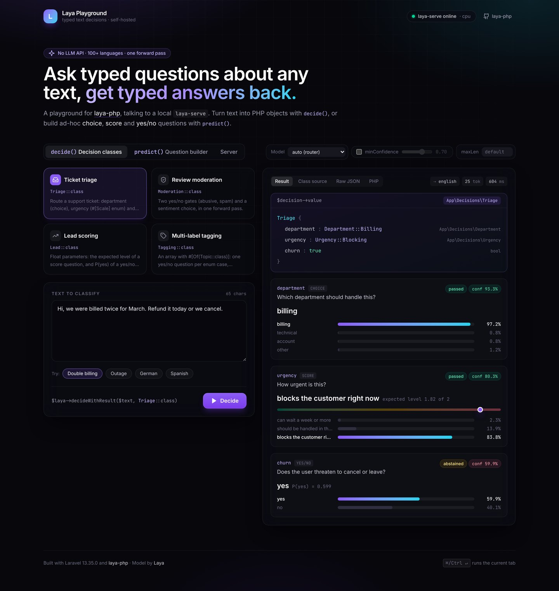
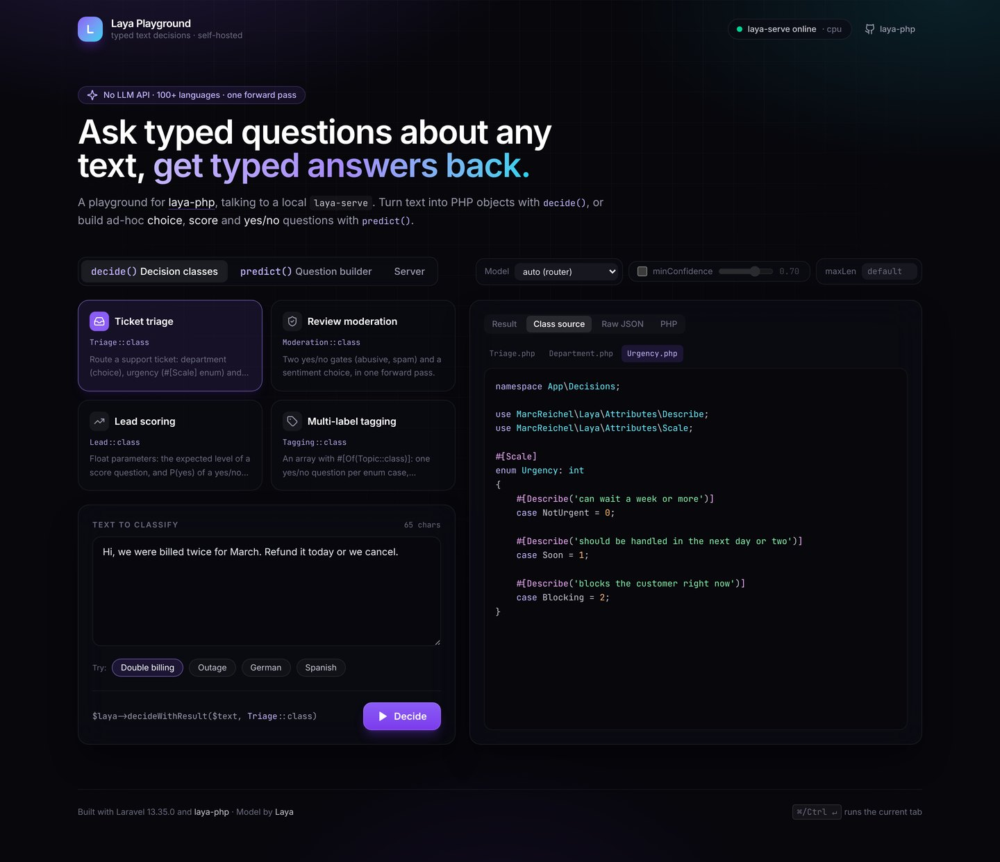
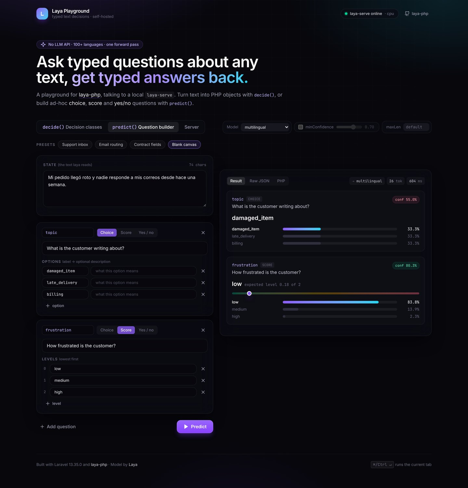
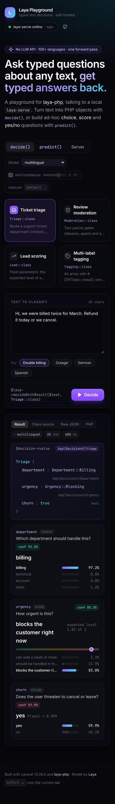

# Laya Playground

A small Laravel app for trying out [laya-php](https://github.com/marcreichel/laya-php), which does self-hosted, multilingual text classification and returns typed results. One command starts the app together with a local [Laya](https://github.com/NandhaKishorM/laya) model server, so you can try the SDK in a browser without writing code first.



> Background reading: [LayaPHP: Self-Hosted Text Classification for PHP and Laravel](https://laravel-news.com/laya-php-self-hosted-classification) on Laravel News.

## Quick start

You need Docker with Compose v2, about 8 GB of RAM and 10 GB of free disk.

```bash
git clone https://github.com/earthlingollie/laya-laravel-playground.git
cd laya-laravel-playground
docker compose up --build
```

Then open **http://localhost:8080**.

The first run takes a while. It installs PyTorch (CPU) into the `laya` image, then downloads the English and multilingual checkpoints (about 2 GB) from Hugging Face. The status pill in the top right reads *laya-serve offline* until the model has loaded, then turns green. The weights are kept in the `laya-models` volume, so later starts take seconds.

| Setting (env or `.env` next to `compose.yaml`) | Default | What it does |
|---|---|---|
| `APP_PORT` | `8080` | Port the playground listens on |
| `LAYA_PORT` | `8000` | Host port for laya-serve, bound to `127.0.0.1`, so you can also call it directly |
| `LAYA_PRELOAD` | `1` | Load the checkpoints at startup. Set `0` to load each one on its first request |
| `LAYA_MODELS` | `english,multilingual` | Checkpoints to preload. Add `typed-decisions` if you pin that model |
| `LAYA_API_KEY` | *(none)* | Require a bearer token on laya-serve. Both services get the same value |
| `OMP_NUM_THREADS` | `4` | CPU threads for inference |

Useful commands:

```bash
docker compose logs -f laya          # watch the model download and load
docker compose exec app php artisan laya:health
docker compose exec app php artisan laya:try "Decisions\Triage" "Refund me or I cancel"
docker compose down                  # stop it; add -v to also delete the downloaded weights
```

## What you can do

### `decide()`: decision classes

Choose one of the classes in [`app/Decisions`](app/Decisions), pick a sample text (several are not in English) or paste your own, and run it. The result panel shows:

- **the object** that `decideWithResult()` returns, printed the way PHP would show it, e.g. `Department::Billing`, `Urgency::Blocking` or `true`;
- **every answer's probabilities**, along with `answerConfidence` and, if you turn on `minConfidence`, whether laya-serve's abstention gate passed or abstained;
- **the class source**, **the raw JSON** from laya-serve, and **a PHP snippet** you can copy that reproduces the call.

| Class | Shows |
|---|---|
| `Triage` | backed-enum choice, `#[Scale]` enum score, yes/no `bool` with a `yes:` description |
| `Moderation` | two yes/no gates plus a sentiment choice, all in one forward pass |
| `Lead` | `float` parameters: the expected level of a score question, and P(yes) |
| `Tagging` | multi-label: `array` with `#[Of(Topic::class)]`, one yes/no question per case |



### `predict()`: question builder

Write your own **choice**, **score** and **yes/no** questions, or start from a preset (support inbox, email routing, contract fields), and run them against any text. The PHP tab writes out the matching `Question::choice()` / `score()` / `yesNo()` calls.



### Options

The toolbar options apply to both tabs: **Model** (let laya's router choose, or pin `english`, `multilingual` or `typed-decisions`), **minConfidence** (server-side abstention) and **maxLen** (token budget for long text). Press <kbd>⌘/Ctrl</kbd> + <kbd>↵</kbd> to run the current tab.

The **Server** tab shows laya-serve's health, device, loaded checkpoints and revisions.



## How it fits together

```
browser (Blade + Alpine.js)
   │  GET /api/health · POST /api/decide · POST /api/predict
   ▼
app: Laravel 13 + laya-php      ── app/Http/Controllers/PlaygroundController.php
   │  POST /v1/systemone (via laya-php's auto-discovered Laya singleton)
   ▼
laya: laya-serve (FastAPI + PyTorch, CPU)   ── upstream Laya Dockerfile, pinned to v0.4.6
```

- [`PlaygroundController`](app/Http/Controllers/PlaygroundController.php) has the three endpoints. Validation and the mapping from laya-php exceptions to HTTP errors live there too.
- [`App\Playground\Catalog`](app/Playground/Catalog.php) lists the decision classes, sample texts and presets. Add your own class to `app/Decisions` and register it there.
- [`App\Playground\Present`](app/Playground/Present.php) converts `Result`, `Answer` and decision objects to JSON for the UI.
- The front end is a single Blade page ([`resources/views`](resources/views)) with an Alpine component ([`resources/js/app.js`](resources/js/app.js)), styled with Tailwind 4.
- The app has no database. Sessions and cache are stored as files.

## Developing without Docker

The app needs PHP 8.4+, Composer and Node 22+, plus a laya-serve to talk to (start just that service with `docker compose up laya`).

```bash
composer setup                       # composer install, .env, app key, npm install + build
php artisan serve --port=8080        # LAYA_URL in .env defaults to http://localhost:8000
npm run dev                          # optional: Vite with hot reload
```

## Tests

**Feature tests** run without a server. They use laya-php's `Laya::fake()`:

```bash
php vendor/bin/phpunit
```

**End-to-end walkthrough.** A Playwright script drives the whole UI in Chromium: every decision class, all three presets, a custom question set, the PHP and raw views, a validation error, the server tab and a phone-sized viewport. It saves a screenshot after each step:

```bash
docker compose up -d --build
cd tests/e2e && npm install && npx playwright install chromium
node walkthrough.mjs                 # screenshots land in tests/e2e/screenshots/
```

> The screenshots in this README come from that walkthrough. They were taken in a sandbox that could not reach Hugging Face, so the model server used there was a stand-in that speaks laya-serve's wire protocol. The layout matches what you will see, but the numbers are illustrative and are not real Laya predictions.

## Credits

- [laya-php](https://github.com/marcreichel/laya-php) by Marc Reichel (Apache-2.0)
- [Laya](https://github.com/NandhaKishorM/laya) by Nandha Kishor M (Apache-2.0)
